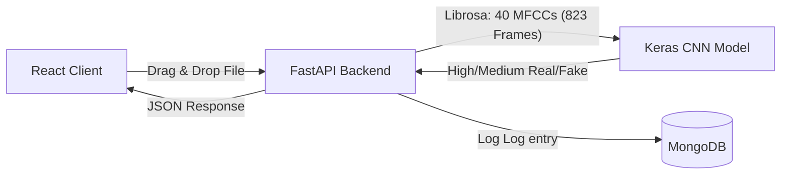

# AudioVerifier: Concise Step-by-Step Implementation Guide

This document provides a streamlined, step-by-step blueprint to configure, build, and run the **AudioVerifier Audio Deepfake Detector** from scratch. 

---

## 🗺️ System Architecture & Data Flow



---

## 🛠️ Phase 1: Environment Configuration

### 1.1 Prerequisites
* **Python 3.10+** (with pip added to your system PATH).
* **NodeJS (v18+)** (for the Vite React client).
* **MongoDB Community Server** (running locally on port `27017`).

### 1.2 Model File Location
Ensure your trained model file `deepfake_audio_20k_model.keras` is placed directly in the root directory:
```text
mini_project/
├── deepfake_audio_20k_model.keras
```

---

## ⚙️ Phase 2: Asynchronous Backend Setup

### 2.1 Virtual Environment
Initialize a clean Python virtual environment and activate it:
```powershell
cd backend
python -m venv venv_tf
.\venv_tf\Scripts\activate
```

### 2.2 Dependencies
Create a `requirements.txt` file under `backend/` and install them:
```text
fastapi
uvicorn
python-multipart
motor
librosa
numpy
python-jose[cryptography]
passlib[bcrypt]
tensorflow
```
Install using pip:
```powershell
pip install -r requirements.txt
```

### 2.3 Directory Structures
Ensure your backend workspace directories exist:
```powershell
mkdir routes, services, uploads
```

---

## 💻 Phase 3: React Frontend Setup

### 3.1 Initialize React Client
From the root directory, create a clean React + Vite application:
```powershell
npx -y create-vite@latest frontend --template react
cd frontend
npm install
```

### 3.2 Install Frontend Packages
Install the required vector icons, styling, routing, and HTTP client packages:
```powershell
npm install axios framer-motion lucide-react react-dropzone react-router-dom
```

### 3.3 Configure Vite API Proxying
Configure Vite to transparently route all frontend `/api/*` endpoints to the FastAPI port `8000`:

#### `frontend/vite.config.js`
```javascript
import { defineConfig } from 'vite'
import react from '@vitejs/plugin-react'

export default defineConfig({
  plugins: [react()],
  server: {
    port: 3000,
    proxy: {
      '/api': {
        target: 'http://127.0.0.1:8000',
        changeOrigin: true
      }
    }
  }
})
```

---

## 🚀 Phase 4: Execution & Launch Operations

To launch both systems simultaneously, run this automated PowerShell script in your root directory.

### 4.1 Orchestration Script: `start.ps1`
```powershell
$env:PYTHONPATH="."
Write-Host "Launching Backend (FastAPI)..." -ForegroundColor Cyan
Start-Process powershell -ArgumentList "-NoExit -Command cd '$PWD'; `$env:PYTHONPATH='.'; .\backend\venv_tf\Scripts\python -m uvicorn backend.main:app --host 0.0.0.0 --port 8000 --reload"

Write-Host "Launching Frontend (React+Vite)..." -ForegroundColor Magenta
Start-Process powershell -ArgumentList "-NoExit -Command cd '$PWD\frontend'; npm run dev"
```

Execute using:
```powershell
powershell -ExecutionPolicy Bypass -File .\start.ps1
```

---

## 🔍 Phase 5: Verification Checklist

Verify your endpoints are operational:

1. **MongoDB Connection**: Ensure the service is active on port `27017`.
2. **FastAPI Backend Check**: Open [http://localhost:8000/](http://localhost:8000/) in your browser; it should return:
   ```json
   {"status":"ok","service":"Audio Deepfake Detection Backend"}
   ```
3. **Frontend Application**: Navigate to [http://localhost:3000/](http://localhost:3000/) to access the dashboard.
4. **Command Line Handshake Audit**:
   ```bash
   curl -X POST "http://localhost:8000/api/predict" -F "file=@test.wav"
   ```
