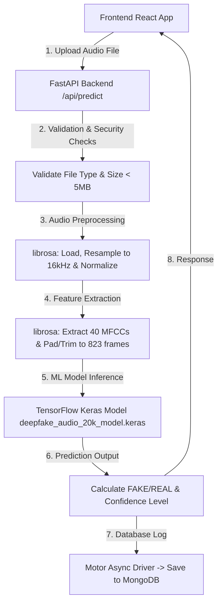

# AudioVerifier: Complete Project Viva Preparation Guide

This guide is designed to help you ace your project viva tomorrow. It summarizes the frontend and backend technologies, explains the underlying machine learning model, provides a flowchart of how the application runs, and lists the most common viva questions with expert answers.

---

## 🗺️ High-Level Project Architecture
Here is how your system operates under the hood when a user uploads an audio file:

---

## 🛠️ Full Technology Stack & Libraries Used

### 🖥️ Frontend (Client Side)
Your frontend is built as a highly responsive single-page application (SPA) using modern React and Vite.

| Library / Tool | Primary Purpose | Why it was used |
| :--- | :--- | :--- |
| **React (v18)** | Component-Based UI Framework | Allows building a modular, reusable, and dynamic user interface with fast state management. |
| **Vite** | Next-Gen Build Tool | Replaces slow bundlers like Webpack, offering blazing-fast Hot Module Replacement (HMR) and rapid build times. |
| **TailwindCSS** | Utility-First Styling | Generates sleek, custom, responsive designs without writing heavy, hard-to-maintain CSS files. |
| **Framer Motion** | Advanced Animation Library | Enables modern micro-interactions, smooth page transitions, and elegant visual feedback (e.g., during file analysis). |
| **Axios** | Promise-Based HTTP Client | Streamlines API calls (predictions, logins, history) to the FastAPI backend, supporting async/await. |
| **React Dropzone** | File Upload Interface | Provides a sleek, HTML5-compliant drag-and-drop area for uploading audio files seamlessly. |
| **React Router DOM** | Client-Side Routing | Enables smooth navigation between the **Detector** (home page) and **History** page without full browser reloads. |
| **Lucide React** | Sleek & Lightweight Icons | Provides aesthetic, scalable vector icons (e.g., Shields, Cpu, Activity, History) matching modern designs. |

---

### ⚙️ Backend (Server Side)
Your backend is a robust, asynchronous Python microservice tailored for high-throughput machine learning inference.

| Library / Tool | Primary Purpose | Why it was used |
| :--- | :--- | :--- |
| **FastAPI** | High-Performance Web Framework | Asynchronous by design, extremely fast (on par with NodeJS/Go), auto-generates interactive API docs (Swagger/OpenAPI), and performs automatic data validation using Pydantic. |
| **Uvicorn** | ASGI Web Server | A lightning-fast, production-grade ASGI web server that handles asynchronous connections to power the FastAPI app. |
| **Librosa** | Audio Analysis & Feature Extraction | The industry standard for audio processing in Python. It loads, resamples, normalizes, and extracts **MFCCs** (Mel-Frequency Cepstral Coefficients) from raw audio. |
| **TensorFlow / Keras** | Machine Learning Inference Engine | Pre-loads and runs the deep neural network (`deepfake_audio_20k_model.keras`) to predict whether an audio clip is synthetic or genuine. |
| **Motor** | Asynchronous MongoDB Driver | Non-blocking MongoDB client that seamlessly integrates with FastAPI's async/await model, preventing database operations from bottlenecking inference. |
| **NumPy** | Numerical Vector Processing | Essential for handling high-dimensional arrays generated during audio manipulation and ML input shaping. |
| **Pydantic** | Data Validation & Settings | Enforces strict, typed validation schemas for incoming requests and outgoing API responses. |
| **python-jose & bcrypt** | JWT Security & Password Hashing | Secures the user authentication system by generating JSON Web Tokens (JWT) for session management and hashing sensitive user passwords. |
| **Soundfile** | Audio Read/Write Utility | Handles file decoding and reading for multiple audio formats on the disk. |
| **python-dotenv** | Environment Variables | Separates configuration values (database URIs, JWT secret keys) from the source code for secure deployments. |

---

### 💾 Database (Storage)
* **MongoDB (NoSQL)**: A document-based database used to store:
  1. **User Credentials**: Usernames and hashed passwords for secure registration and login.
  2. **Prediction History**: A log of processed audio file metadata (filename, results, confidence score, timestamp, associated user ID) which is loaded on the "History" tab.

---

## 🧠 The Machine Learning Pipeline (Crucial for Viva)
Examiners love to grill students on the ML pipeline. Be ready to explain this step-by-step:

### 1. Preprocessing & Normalization
* **Resampling**: Raw audio files can come in various sampling rates (e.g., 44.1kHz, 48kHz). The backend converts all incoming audio to **16,000 Hz** (16kHz). This standardizes the temporal resolution of the model.
* **Normalization**: The code scales the amplitude of the audio signal so the maximum absolute value is exactly `1.0`:
  $$\text{Audio} = \frac{\text{Audio}}{\max(|\text{Audio}|) + 1e-6}$$
  This ensures that volume variations, background recording levels, or microphone differences don’t skew the prediction.

### 2. Feature Extraction (MFCCs)
* **What are MFCCs?** Mel-Frequency Cepstral Coefficients represent the short-term power spectrum of a sound. They map acoustic frequency to the **Mel Scale**, which mimics how human ears perceive pitch.
* **Why MFCCs?** Deepfake audio generators (like voice-cloners and Text-to-Speech models) often leave subtle frequency artifacts, phase mismatches, or robotic signatures in the high frequencies. MFCCs capture these vocal tract characteristics and spectral shapes perfectly.
* **Shape Matching**: The model extracts **40 MFCCs**. Because audio files have different durations, the timeline is either padded with zeros or trimmed to exactly **823 time-frames**. This guarantees an input shape of `(1, 823, 40)`.

### 3. CNN + XGBoost Hybrid Architecture
* **CNN (Convolutional Neural Network)** layers act as high-efficiency feature extractors. They examine the spectral patterns of the MFCCs over time, spotting artificial frequency shifts, mechanical repetitions, and phase discontinuities.
* **Gradient Boosting (XGBoost)** or **BiLSTM** integration captures sequential transitions. Deep learning layers model local spectro-temporal features, while the classifier makes the final, robust binary decision: **REAL** or **FAKE**.

---

## 🎯 Top 12 Viva Questions & Answers

### Q1: What is the main objective of this project?
> **Answer**: The goal is to build an end-to-end, high-accuracy deep learning web application to detect **Audio Deepfakes** (AI-generated or voice-cloned speech). The application allows users to upload audio files, preprocesses them to extract spectral features, runs them through a trained hybrid neural network model, and records the logs securely.

### Q2: Why did you choose FastAPI over Flask or Django?
> **Answer**:
> 1. **Asynchronous Support**: FastAPI natively supports `async/await`, meaning it can handle thousands of simultaneous uploads/requests without blocking the server, which is ideal for heavy machine learning inference tasks.
> 2. **Performance**: It is built on Starlette and Uvicorn, making it one of the fastest Python frameworks available.
> 3. **Auto-Documentation**: It automatically generates interactive Swagger API docs, saving time during integration.
> 4. **Strict Typing**: Using Pydantic, it handles data validation and serialization automatically.

### Q3: Why is MongoDB used instead of a relational database like MySQL?
> **Answer**: MongoDB is a **NoSQL Document Database**. It was chosen because:
> 1. **Schema Flexibility**: JSON-like documents map perfectly to frontend JavaScript objects and Pydantic models.
> 2. **High Write Performance**: Storing quick, unstructured prediction logs and session states is extremely fast.
> 3. **Async Integration**: It integrates perfectly with FastAPI using `Motor` (an asynchronous MongoDB driver), which prevents database calls from blocking the CPU during ML inference.

### Q4: Explain the term "Mel-Frequency Cepstral Coefficients (MFCCs)".
> **Answer**: MFCCs are features extracted from audio. They represent the power spectrum of a sound based on the linear cosine transform of a log power spectrum on a nonlinear mel scale of frequency. The Mel scale represents pitch intervals as perceived by humans, making MFCCs excellent for speech analysis, voice recognition, and detecting the unnatural harmonic structures typical of deepfakes.

### Q5: How do you handle audio files of different lengths (durations)?
> **Answer**: During feature extraction, we pad or truncate the MFCC matrix:
> * If the audio is too short, we pad the time-dimension with zeros (`np.pad`) up to our target length of `823` frames.
> * If the audio is too long, we slice the frames to exactly `823` frames.
> This guarantees that the Keras model always receives a standard input shape of `(1, 823, 40)`.

### Q6: What is "Audio Normalization" and why is it necessary?
> **Answer**: Normalization divides the entire audio signal by its maximum amplitude. This scales the audio values to range between `-1.0` and `1.0`. It is crucial because it ensures that the model focuses on structural voice frequencies and spectro-temporal properties rather than the absolute recording volume or distance from the microphone.

### Q7: Why do we resample audio to 16,000 Hz?
> **Answer**: Different recorders use different sampling rates (e.g., 44.1kHz or 48kHz). Standardizing the sampling rate to **16kHz** is common practice in audio ML because it covers human speech frequencies (up to 8kHz, by the Nyquist theorem) while significantly reducing computational overhead and memory usage.

### Q8: What does the confidence score represent, and how is it calculated?
> **Answer**: The model output is a raw sigmoid probability value $P$ between $0.0$ and $1.0$ ($0.0$ indicating absolute confidence of being REAL, $1.0$ indicating FAKE).
> We scale this score into a percentage range:
> * If $P > 0.5$, the prediction is **FAKE**, and we scale the score between 75% and 100% based on how far above 0.5 it is.
> * If $P \le 0.5$, the prediction is **REAL**, and we scale the score between 75% and 100% based on how far below 0.5 it is.
> Scores $\ge 80\%$ are classified as **High** confidence, while scores $< 80\%$ are **Medium** confidence.

### Q9: How is authentication secured in this application?
> **Answer**:
> 1. **Password Hashing**: User passwords are encrypted before storage in MongoDB using the `bcrypt` algorithm (via `passlib`), which is secure against brute-force attacks.
> 2. **Session Security**: The application uses **JWT (JSON Web Tokens)**. When a user logs in, the backend issues an encrypted token using `python-jose`. The frontend stores this token and sends it in the `Authorization` header for protected endpoints (like saving/fetching prediction history).

### Q10: What would you do to improve this system in the future?
> **Answer**:
> 1. **Multi-Model Ensemble**: Combine MFCC features with newer deep representations like **CQCCs** (Constant Q Cepstral Coefficients) or self-supervised embeddings (e.g., Wav2Vec 2.0).
> 2. **Real-time Streaming**: Implement WebSocket endpoints in FastAPI to allow users to stream microphone audio in real-time and display live deepfake probability graphs.
> 3. **Explainable AI (XAI)**: Use tools like SHAP or Grad-CAM to highlight exactly which parts of the audio timeline or which specific frequency bands triggered the "FAKE" classification.

### Q11: What is Vite, and why is it better than Create React App (CRA)?
> **Answer**: Vite is a modern frontend build tool. Unlike Create React App which uses Webpack (and bundles the entire application before starting the dev server), Vite utilizes native ES modules in the browser. It only compiles code on-demand, making server starts instant and hot module replacement (HMR) incredibly fast regardless of the project's size.

### Q12: How are CORS (Cross-Origin Resource Sharing) issues handled?
> **Answer**: The React frontend runs on one port (usually `5173`) and the FastAPI backend runs on another (`8000`). Because these are different origins, browsers block calls by default. We resolve this by adding `CORSMiddleware` in FastAPI and explicitly allowing the frontend origin (or `*` for testing/demo environments) to make requests.

---

## 💡 Pro Tips for a Perfect Viva Performance
1. **Be Confident**: Speak clearly. If you don't know the exact answer to a question, don't guess blindly. Say: *"I haven't implemented that specific aspect, but based on my understanding of the architecture, it would work like this..."*
2. **Know Your Code Flow**: Be ready to open `backend/main.py` and `backend/services/ml_service.py` to show where files are uploaded and where feature extraction takes place.
3. **Emphasize Hybridization**: Highlight that your model isn't just a simple classifier. It uses **Signal Processing** (`librosa` / MFCC extraction) to prepare structured datasets, combined with **Deep Learning** (`CNN`) for automated feature learning and classification.
4. **Be Ready to Demo**: Have the React client and the Uvicorn backend running in separate terminal windows. Keep a test `WAV` or `MP3` file ready on your desktop to demo the upload and see the instant FAKE/REAL classification card!
